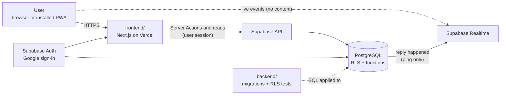

# Cleofas

A web app where people can post rants, and others can reply depending on the post's privacy setting (public or friends/mutuals).

<p>
  
</p>

Status: MVP and Phase 2 built (see section 9)
Platform: Web app (installable PWA), free tier stack

---

## 1. Goals

- Give people a safe place to rant, with control over who can see and reply.
- Keep it simple: post, reply, follow. Nothing else at first.
- Zero cost at the start (free tiers only).

## 2. Non-Goals (for the MVP)

- Native mobile app (Play Store / App Store)
- Image and video uploads
- Direct messages
- Algorithmic feed or recommendations
- Monetization

---

## 3. Core Features (MVP)

### 3.1 Auth
- Sign up and log in with Google (Gmail) only, no email + password
- Unique username
- Basic profile (display name, bio)

### 3.2 Posts (Rants)
- Create a text post (max 1000 characters)
- Visibility per post:
  - Public: any logged-in user can see and reply
  - Mutuals: only mutual follows can see and reply
- Edit and delete own posts
- Anonymous posting: tick "Post anonymously" when writing. Anonymous posts are always public, the author is hidden from everyone (even on the author's profile and in Following), and a block never reveals or hides them. Moderators can still see the author when a post is reported

### 3.3 Replies
- Who can reply follows the post's visibility:
  - Public post: anyone can reply
  - Friends (mutuals) post: only mutual friends can reply
- Identity setting: a reply can be shown with the replier's username or anonymously, controlled through a settings option
- Edit and delete own replies
- The post author can delete any reply on their post

### 3.4 Follow System
- Follow and unfollow
- Mutual = both users follow each other
- Followers and following lists

### 3.5 Feed
- Home feed: posts from people you follow plus public posts (chronological first)
- Profile page: a user's posts, filtered by the visibility rules
- Infinite scroll on the feed and on profiles (cursor paging by created_at + id)
- Muted words (Settings): posts and other people's replies that contain a muted word are hidden from you. Whole words, not case sensitive, up to 30 words

### 3.5b Notifications and live updates
- Notification when someone replies to your post (bell link with an unread badge). Anonymous repliers are never named
- Replies and the unread badge update live (Supabase Realtime). The live events carry no content, the page re-reads through the normal functions, so nothing can leak through realtime
- Installable as an app (PWA): manifest, icons and an offline page. Nothing personal is cached on the device

### 3.5c Moderation
- Admins get a Moderation page (Settings > Moderator tools) with open, reviewed and dismissed reports. Each report keeps a copy of the text and the real author, even if the content is deleted. Admins can mark reports, dismiss them or remove the content
- Admins are rows in the admins table, and every admin action goes through a database function that checks it. The app never uses the service key

### 3.6 Safety (part of the MVP, not optional)
- Report a post or reply
- Block a user (hidden from each other, cannot reply). Blocking hides the blocked user's posts and NON-anonymous replies only; anonymous replies are never hidden by a block (see section 6)
- Rate limiting on posts and replies
- Crisis resources link on the footer and compose page
- Basic content filter (slurs, spam): muted words are built (each user chooses their own). A shared slur/spam filter is still open

---

## 4. Tech Stack

| | Layer | Choice | Why |
|---|---|---|---|
|  | Frontend framework | Next.js 16 (App Router, Server Actions, proxy) | SSR, one codebase for pages and server code |
|  | UI | React 19 | Components, `useActionState` forms |
|  | Language | TypeScript | Safer code |
|  | Styling | Tailwind CSS 4 | Fast UI work, light/dark theme with CSS variables |
|  | Backend platform | Supabase | Auth, database API and realtime in one |
|  | Database | PostgreSQL + Row Level Security | Privacy rules that cannot be bypassed from the frontend |
|  | Hosting | Vercel (Hobby, free) | Easy Next.js deploys |
|  | Tooling | Node.js, npm | Runs the app and the database tests |
|  | Source | GitHub | Version control |

Also used: Supabase Auth (Google sign-in only), Supabase Realtime (private broadcast channels), a small service worker (PWA), PGlite (in-memory Postgres for the RLS tests).

### System structure



How a request flows:
1. The browser asks Next.js for a page. `proxy.ts` refreshes the session and sends signed-out visitors to `/login`.
2. The page (a Server Component) reads data through database functions such as `list_posts`, `get_post` and `get_replies`, using the signed-in user's session.
3. The database decides what the user may see (RLS and the functions). The frontend never filters private data itself.
4. Changes (post, reply, follow, block, report) are Server Actions. They validate input, then write with the same session, and the database checks the rules again.
5. When someone replies, a database trigger creates a notification and sends a content-free realtime ping. Open pages re-read through the normal functions.

Layers, from outside to inside:

| Layer | Where | Job |
|---|---|---|
| Pages and components | `frontend/app`, `frontend/components` | What the user sees and clicks |
| Server Actions | `frontend/app/actions.ts` | Validate input, call the database, show errors |
| Data helpers | `frontend/lib` | Auth, post queries, constants, formatting |
| Database functions | `backend/supabase/migrations` | Who can see what, anonymity, counts, notifications, moderation |
| Tables with RLS | `backend/supabase/migrations` | Last line of defense: direct table access is limited to the owner |

### Free tier limits to remember
- Supabase free projects pause after about a week of inactivity (can be resumed manually)
- Limited database size and bandwidth
- Vercel Hobby plan is for non-commercial use only

---

## 5. Data Model

### profiles
| Field | Notes |
|---|---|
| id | Same as the auth user id |
| username | Unique, 3-20 chars, lowercase letters, numbers, underscore |
| display_name | Optional |
| bio | Max 160 chars |
| created_at | Timestamp |

Private per-user settings live in profile_private (own row only, never readable by other users), not in profiles.

### profile_private
| Field | Notes |
|---|---|
| id | Same as the profile id |
| default_anonymous_replies | Reply composer starts with "anonymous" ticked (the reply identity setting, section 3.3) |
| muted_words | Up to 30 words (1-40 characters) hidden from the user's feed and replies |

### follows
| Field | Notes |
|---|---|
| follower_id | The user who follows |
| following_id | The user being followed |
| created_at | Timestamp |

Primary key is the pair (follower_id, following_id). A user cannot follow themselves.

### blocks
| Field | Notes |
|---|---|
| blocker_id | The user who blocks |
| blocked_id | The user being blocked |
| created_at | Timestamp |

Primary key is the pair (blocker_id, blocked_id). A user cannot block themselves.

### posts
| Field | Notes |
|---|---|
| id | Unique id |
| author_id | References profiles |
| body | 1-1000 chars |
| visibility | "public" or "mutuals" (default public) |
| is_anonymous | Anonymous post (default false). Only allowed with visibility "public". Cannot be changed after posting |
| created_at / updated_at | Timestamps |

Indexes: by (author_id, created_at) and by created_at, both descending.

### replies
| Field | Notes |
|---|---|
| id | Unique id |
| post_id | References posts, deleted with the post |
| author_id | References profiles |
| body | 1-500 chars |
| is_anonymous | True if the reply is shown without the replier's identity |
| created_at | Timestamp |

Index: by (post_id, created_at).

Anonymous reply note: author_id is still stored (needed for moderation) but must never be returned to other users for anonymous replies. Expose replies through a database view or function that hides author_id when is_anonymous is true, and do not let clients query the raw replies table directly.

### reports
| Field | Notes |
|---|---|
| id | Unique id |
| reporter_id | References profiles |
| post_id / reply_id | At least one must be set |
| reason | Required text |
| status | open, reviewed, or dismissed (default open) |
| target_author_id | Real author of the reported post or reply (filled by a trigger). Moderators only: reporters cannot read it, because it would unmask anonymous repliers |
| target_body | Copy of the reported text at report time, so the evidence survives if the content is deleted |
| created_at | Timestamp |

If the reported post or reply is deleted, post_id / reply_id become empty but the snapshot stays. One report per user per target.

### notifications
| Field | Notes |
|---|---|
| id | Unique id |
| user_id | The post author who gets the notification |
| post_id / reply_id | What happened. Deleting the reply deletes the notification |
| created_at / read_at | Timestamps (read_at empty = unread) |

Only ids are stored. The replier's name is looked up when reading, and only for non-anonymous replies. Clients cannot read this table directly, only through get_notifications().

### admins
| Field | Notes |
|---|---|
| user_id | A profile that is a moderator |
| created_at | Timestamp |

No client can read or write this table. Add an admin once from the Supabase SQL Editor (section 8).

### Helper logic (database functions)
- is_mutual(a, b): true when a follows b and b follows a
- is_blocked(a, b): true when either user has blocked the other
- Both is_* helpers run with elevated rights so RLS policies can call them safely
- post_visible(author, visibility, anonymous): the one place that decides if you may see a post. Anonymous posts ignore blocks on purpose
- get_post(post) / list_posts(author, following_only, before, limit, before_id): posts for the post page, feed and profiles, with the author blanked for anonymous posts and the visible reply count included
- get_replies(post): the only way to read replies; hides author_id / username for anonymous replies and applies blocks and muted words
- get_notifications(), unread_notification_count(), mark_notifications_read(): notifications, with the same block rule as replies
- is_admin(), admin_list_reports(), admin_set_report_status(), admin_remove_target(): moderation, all check is_admin() first
- search_profiles(term): username prefix search without yourself or blocked users, in one call
- complete_onboarding(...): sets the username, display name and bio
- delete_my_account(): deletes the user and everything they own
- A trigger on new auth users auto-creates a profile (temporary username) and its profile_private row
- A trigger on new replies creates the notification and sends the realtime ping (the ping never carries content and can never block a reply)

---

## 6. Privacy Rules (RLS)

RLS must be enabled on every table. Privacy is enforced in the database, never only in the frontend.

| Action | Rule |
|---|---|
| View post | Author, OR anonymous (public by rule, blocks ignored), OR (public AND not blocked), OR (mutuals AND mutual AND not blocked). Other people's anonymous posts are only returned by get_post / list_posts, never by a direct table read |
| Create post | Authenticated, and author is the current user. Anonymous posts must be public |
| Edit / delete post | Author only |
| View reply | Only if the parent post is visible. Non-anonymous replies are also hidden when either side blocked the other. Anonymous replies are never hidden by a block |
| Create reply | Only if the parent post is visible, not blocked, and author is the current user |
| Delete reply | Reply author or post author |
| Follow / unfollow | Own follow rows only |
| Block / unblock | Own block rows only |
| View profiles | Any authenticated user (public fields only; private settings are in profile_private, own row only) |
| Create report | Authenticated, reporter is the current user, target visible to them |
| View reports | Own reports only, without target_author_id / target_body. Admins read all reports through admin_list_reports() |
| Notifications | Closed table. Read your own through get_notifications() only |
| Muted words | Own row only (profile_private) |
| Moderation | Only users in the admins table, checked inside each function |
| Realtime channels | post:<id> only for people who can see the post, user:<id> only for that user |

Notes:
- Reply visibility piggybacks on post visibility: if you cannot see the post, you cannot see or add replies.
- Blocking works in both directions for posts, profiles and follows.
- Anonymous replies hide the replier's identity from everyone except moderators.
- Blocks must NOT hide anonymous replies. If they did, a post author could block a suspect and see whether the reply disappears (and unblock to repeat), which unmasks the replier. Blocks only hide non-anonymous replies, where the author is already visible.
- Anonymous replies on mutuals-only posts come from a small group (only mutuals can reply), so they are easier to guess. This is not a bug, and the reply form tells the user.
- Anonymous posts follow the same idea: if blocks hid them, blocking a suspect would reveal the author. They are public only, never shown on the author's profile or in the Following tab (appearing there would show the author is someone you follow), and the author is blanked in the database, not in the frontend.
- Notifications about anonymous replies never name the replier, and a notification disappears only when its reply is deleted.
- Known limit: after a block the blocked user can no longer see or reply to the blocker's future posts. In a very small group the post author can notice that replies stopped, so anonymity is strong on public posts and weaker on small mutuals posts.

---

## 7. Project Structure

```
CLEOFAS/
├─ README.md                     this document (plan, data model, rules, roadmap)
├─ SETUP.md                      how to set up and run everything
├─ frontend/                     Next.js app (deploy this folder to Vercel)
│  ├─ app/
│  │  ├─ layout.tsx              header, theme script, notifications badge, live refresh
│  │  ├─ page.tsx                home feed (Everyone / Following)
│  │  ├─ actions.ts              all Server Actions (posts, replies, follow, block, report, admin)
│  │  ├─ login/ auth/ onboarding/
│  │  ├─ post/[id]/              post page with replies (live)
│  │  ├─ u/[username]/           profile, followers, following
│  │  ├─ search/ settings/ help/
│  │  ├─ notifications/          reply notifications
│  │  ├─ admin/                  moderation (admins only)
│  │  ├─ manifest.ts, icon.png   PWA manifest and icons
│  │  └─ globals.css             theme tokens (sage green light, pastel green dark)
│  ├─ components/                PostCard, PostList (infinite scroll), PostComposer, ReplyList,
│  │                             ActionForm, ThemeToggle, LiveRefresh, MutedWordsForm, ...
│  ├─ lib/                       auth helper, post queries, supabase clients, constants, types
│  ├─ public/                    sw.js (service worker), offline.html, icons/
│  └─ proxy.ts                   refreshes the session, sends signed-out visitors to /login
└─ backend/                      the database, where all privacy rules live
   ├─ supabase/migrations/       0001 schema, 0002 functions, 0003 RLS, 0004 hardening,
   │                             0005 remove age gate, 0006 phase 2
   └─ tests/rls.test.mjs         the section 10 checklist, run against an in-memory Postgres
```

---

## 8. Setup Steps (high level)

1. Create a Supabase project (free tier)
2. Create the tables, helper functions, trigger, and RLS policies from sections 5 and 6 as migration files
3. Realtime: nothing to turn on for tables. The app uses private broadcast channels (migration 0006 creates the policy). If live updates do not work, check that Realtime is enabled for the project and that "Allow public access" is off in Realtime settings
4. Create the Next.js project with TypeScript and Tailwind
5. Add the Supabase client libraries and environment variables (project URL and anon key)
6. Deploy to Vercel (Root Directory: `frontend`) and set the same environment variables there
7. To become a moderator, sign in once, then run in the SQL Editor: `insert into public.admins (user_id) select id from public.profiles where username = 'your_username';`

---

## 9. Build Roadmap

### Phase 0 - Setup
- [x] Supabase project and env vars
- [x] Schema and RLS
- [ ] Next.js project deployed to Vercel (runs locally; deploy with Root Directory `frontend`)

### Phase 1 - MVP
- [x] Auth (sign up, log in, log out)
- [x] Profile and username setup
- [x] Create post with visibility picker
- [x] Feed (public + following)
- [x] Post page with replies
- [x] Follow / unfollow with mutual indicator
- [x] Block and report
- [x] Rate limiting
- [x] Crisis resources banner
- [x] RLS testing (public, mutuals, blocked cases)

### Phase 1.5 - Hardening (2026-10-29, migration 0004)
- [x] Blocks no longer unmask anonymous replies
- [x] Age notice on the login page (13+). A stored, enforced age gate was tried in 0004 and removed in 0005 because this is a side project
- [x] Private settings moved to profile_private
- [x] Reports keep evidence and hide the real author from reporters
- [x] Errors shown for delete, follow, block (no more silent failures)
- [x] One-call feed, profile posts and search (no N+1)
- [x] Rate limit on blocks, reserved usernames, delete my account, security headers

### Phase 2 - Improve (2026-10-29, migration 0006)
- [x] Realtime replies and live notification badge (content-free private channels)
- [x] Notifications (reply on your post). Anonymous repliers are never named, no "reply hidden / removed" events
- [x] PWA install support (manifest, icons, offline page, service worker that caches nothing private). Needs HTTPS, so it works after the Vercel deploy
- [x] Anonymous posting option (public only, blocks never reveal it)
- [x] Muted words
- [x] Admin moderation page for reports (database functions with an admins table, no service key)
- [x] Infinite scroll
- [x] Theme: sage/pastel green with an animated light/dark switch (remembers your choice, follows your device at first)

### Phase 3 - Later
- [ ] "Vent mode" (posts auto-delete after X days)
- [ ] Reactions (hug, relate, etc.) instead of likes
- [ ] Content warning toggle
- [ ] Email notifications
- [ ] Native wrapper (Capacitor) if really needed

---

## 10. Testing Checklist (RLS)

| Scenario | Expected |
|---|---|
| A posts public, B does not follow A | B can see and reply |
| A posts mutuals, B follows A only (not mutual) | B cannot see |
| A posts mutuals, A and B are mutual | B can see and reply |
| A blocks B, A posts public | B cannot see |
| B blocks A | A cannot see B's posts or reply to them |
| B replies to A's post, A deletes the reply | Success |
| C tries to delete B's reply | Denied |
| Unauthenticated visitor | No access |
| B replies anonymously, A blocks B, then unblocks | A sees the same anonymous reply every time, never the author |
| B replies with his name, A blocks B | A no longer sees that reply. Reply counts match |
| Reporter reads own report | Cannot read target_author_id or target_body |
| Reported reply is deleted | The report keeps the text and the author id |
| Another user reads profile_private | Sees only their own row |
| Anonymous post, viewer is not the author | author_id and username are null; a direct table read returns nothing |
| Anonymous post, A blocks B and unblocks | A sees the same post every time (no oracle) |
| Anonymous post on a profile or in Following | Not shown (only the author sees it on their own profile) |
| Anonymous reply | Notification never names the replier; blocks hide only named replies; counts match |
| Muted words | Hide others' posts and replies, never your own; regex characters are escaped; max 30 words |
| Cursor paging with equal timestamps | No repeats, no skips |
| Non-admin calls admin functions | Rejected. Admins see the real author of a reported anonymous reply |
| Same user reports the same target twice | Second report is rejected |

---

## 11. Safety and Moderation Notes

- Collect minimal data (email only) and avoid storing anything sensitive that is not needed.
- Rants may include mental health content. Add a crisis resources link (PH hotlines) and verify the numbers before publishing, since they change.
- Write Terms of Service and a Privacy Policy before any public launch.
- Age: the login page says "By continuing, you confirm that you are at least 13". Nothing is verified or stored. Before a wider public launch, consider a stored confirmation again (it was in 0004 and removed in 0005).
- Users can delete their account (Settings) which removes their data. Reports they filed stay.
- Random or anonymous replies carry abuse risk. Rate limits and a report flow must exist before opening to the public.

---

## 12. Open Questions

- [x] App name: Cleofas
- [x] Replies: both username and anonymous, controlled by a setting
- [x] Who can reply: public post = anyone, friends (mutuals) post = mutual friends only
- [x] Auth: Google (Gmail) sign-in only
- [ ] Target users: a small circle first or open to everyone?
- [ ] Who moderates: just you, or recruit mods?

---

## 13. Notes / Changelog

- 2026-10-23: Initial planning doc. Decided on web app and free tier (Next.js + Supabase + Vercel).
- 2026-10-23: Rewritten in English, code removed from the doc.
- 2026-10-23: App named Cleofas. Reply permissions follow post visibility. Anonymous replies added as a setting (is_anonymous on replies).
- 2026-10-23: Auth decided: Google (Gmail) sign-in only.
- 2026-10-24: Code scaffold built (Next.js 16 + Supabase). Migrations in supabase/migrations, RLS tests in tests/rls.test.mjs (22 passing). Added profiles.default_anonymous_replies for the reply identity setting. Crisis hotline numbers (NCMH) verified against a PIA article dated 2025-10-28.
- 2026-10-29: Security and efficiency pass (migration 0004, 32 tests passing). Fixed block-based deanonymization of anonymous replies; mutuals-only anonymity note shown to users; default_anonymous_replies moved to profile_private (it was readable by every user); reports keep a snapshot and hide the real author from reporters; delete/follow/block show errors; feed, profile posts and search are one database call each; block rate limit, reserved usernames, delete account, security headers, error page, getClaims instead of getUser on reads.
- 2026-10-29: Migration 0005 removes the stored age gate (side project). Age is now only a notice on the login page. 31 tests passing.
- 2026-10-29: Repo split into frontend/ (Next.js) and backend/ (Supabase migrations + RLS tests). Same system, only the folders changed. Run the tests from backend/ (npm test).
- 2026-10-29: Phase 2 built (migration 0006, 45 tests passing): anonymous posts, notifications, realtime, muted words, admin moderation, infinite scroll, PWA. New sage/pastel green theme with animated dark/light switch. README now has the tech stack with icons and the system structure. Phase 0: Supabase project and env vars checked, Vercel deploy still open.
